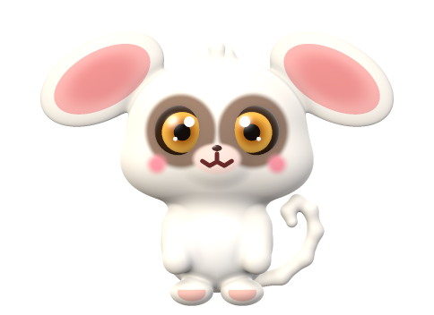
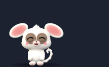
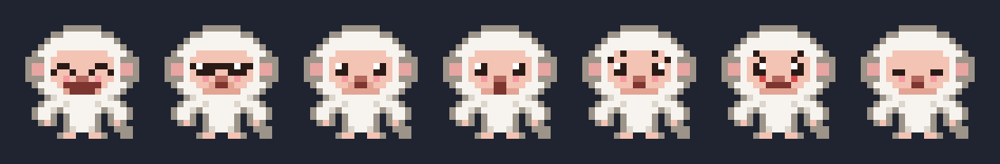
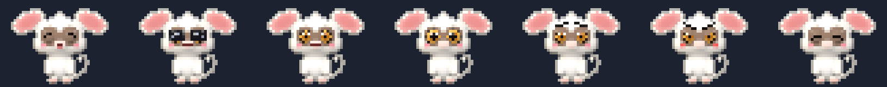

<div align="center">



# monkey-mate

**An emotionally aware companion for Claude Code.**

Momo is a small plush white monkey, all ears and big amber eyes, who lives in a side pane of your Claude Code session. He watches every
tool call, reacts to how the work is going, warns you before destructive commands, and summarises what
changed at the end of every turn.

[](https://github.com/karammm/monkey-mate/actions/workflows/ci.yml)
[](LICENSE)
[](https://claude.com/claude-code)


[Installation](#installation) · [Features](#features) · [Commands](#commands) · [How it works](#how-it-works) · [Contributing](#contributing)

</div>

---

## Why

Long agentic coding sessions are a wall of tool calls. It is easy to miss that the same test has failed
three times, or that a `git reset --hard` just went by. Momo turns those signals into something you notice
at a glance, without blocking or slowing Claude down.

## Features

- **A 3D plush companion.** Momo is a soft 3D model, rendered into shaded full-color sprites for the
  terminal. He hops around his pane, and how often and how high he jumps depends on his mood.
- **Seven moods.** A rule-based mood engine reacts to test results, build results, errors, risky commands and
  the tone of your prompts. It uses no extra tokens and never sends your code anywhere.
- **Destructive-command warnings.** `rm -rf`, `git push --force`, `git reset --hard`, `git clean -f`,
  `DROP TABLE`, `mkfs`, `dd`, and on Windows `Remove-Item -Recurse -Force`, `rd /s` and `del /s`.
- **Repeated-failure detection.** When the same error appears twice in a row, Momo tells you to step back and
  try a different approach.
- **Turn summaries.** At the end of every turn Momo reports the files created and edited, the commands run,
  the test results and any warnings.
- **Emotionally balanced.** Momo's mood drifts back toward calm every turn, and a clean turn halves any grudge.
- **Observe-only.** Momo never blocks, changes or delays a tool call.

<div align="center">

</div>

<div align="center">

</div>

| Mood | When |
| --- | --- |
| 😄 **Happy** | Tests pass, builds succeed, you say thanks |
| 😎 **Proud** | A long streak of successful work |
| 🙂 **Calm** | Nothing notable is happening |
| 🤔 **Curious** | You have just sent a new prompt |
| 😟 **Worried** | A command or test failed, or a destructive command ran |
| 😠 **Angry** | The same error happened twice in a row |
| 😴 **Sleepy** | Nothing has happened for 10 minutes |

## Installation

Requires Claude Code **2.1.303 or later**.

At the prompt of a Claude Code terminal session:

```text
/plugin install monkey-mate --marketplace karammm/monkey-mate
```

Answer `y` to add the marketplace, then choose a scope. Or from a shell:

```bash
claude plugin install monkey-mate --marketplace karammm/monkey-mate
```

In the Claude desktop app: click **+** next to the prompt box, then **Plugins** → **Add marketplace** with
`karammm/monkey-mate` → **Add plugin**.

## Commands

| Command | Description |
| --- | --- |
| `/momo` | Show Momo's mood and the list of commands |
| `/momo changes` | Summarise what changed in the last turn |
| `/momo recap` | Summarise the whole session |
| `/momo pet` | Cheer Momo up |
| `/momo desktop` | Connect to Momo Desktop, or show how to start it |
| `/momo quiet` | Stop warning toasts (the pane and status line still update) |
| `/momo loud` | Turn warning toasts back on |

## Display

| Where | What you see |
| --- | --- |
| Terminal, 110+ columns | A side pane with animated pixel-art Momo, his mood meter and a speech bubble |
| Terminal, narrower | A one-line strip above the prompt |
| Status line | Momo's current mood, always |
| Desktop app, VS Code | The pane with an ASCII Momo (pixel graphics are terminal-only) |

In the terminal Momo is drawn with true-color half-block characters, two pixels per character cell, so he is
a 44×32-pixel version of the 3D renders above:

<div align="center">

</div>

He looks best in a terminal with 24-bit color such as iTerm2, Ghostty, kitty, WezTerm or Windows Terminal;
others show the nearest colors. The pane needs about 46 columns to fit him.

## Momo Desktop: the whole screen

Inside Claude Code, Momo lives in his pane. To let him roam your **whole screen**, start Momo Desktop, a small
companion app (Electron, macOS and Windows) that floats a transparent, click-through layer over everything:

```bash
cd desktop
npm install          # first time only
npm run start:mac    # macOS: runs as Momo.app (needed for push-to-talk and "where you type")
npm start            # Windows and Linux
```

- Momo walks along the top of your Dock or taskbar, leaps around, and sometimes perches high up the screen.
- **Drag** him anywhere and he sits right where you drop him.
- **Click** him for his glass menu: play a tune (he dances), play or pause Spotify or Apple Music, dance, tell
  a joke, ask what is happening, pet him, let him nap, or **Ask Claude…**: type a request such as "run the
  tests" and Momo puts it in Claude Code's prompt box for you to send. Nothing runs without your Enter.
- **Say "Momo"** (macOS) and he listens: "Momo, what's happening?", "Momo, what changed?", "Momo, tell me a
  joke", "Momo, dance", "Momo, stop". He answers out loud in a cute voice, with his mouth moving. Anything else
  ("Momo, run the tests") goes into Claude Code's prompt box for you to send. He only ever talks when you talk
  to him; everything else stays in his bubble.
- Listening for his name keeps the microphone on (macOS shows its orange dot). Speech is turned into text by
  Apple's recognizer, on your Mac whenever it supports that, and he ignores everything until he hears "Momo".
  Turn it off in his menu and use push-to-talk instead: **⌥M** or 🎤 Talk to Momo. Pick his voice (Cute, Tiny,
  Soft) from the 🐒 menu-bar icon.
- **Hover** over him and he giggles ("Hehe! That tickles 😆"); rub the mouse back and forth and he gets
  playfully grumpy ("Hey! Stop teasing me 😤").
- He talks in frosted **liquid-glass** bubbles (the system's own glass material) and thinks out loud while
  Claude works. His mood follows your Claude Code session.
- While you **type**, he politely covers his eyes 🙈 and peeks out when you stop. While you use the mouse he
  keeps still. He only checks how long ago you last used the keyboard or mouse; nothing you type is ever read.
- Clicks anywhere else go straight through to your apps. Quit from the 🐒 menu-bar or tray icon.

The plugin connects by itself (run `/momo desktop` to check). The two talk over `127.0.0.1:47321` only; nothing
leaves your computer.

## How it works

monkey-mate is a Claude Code function-hook plugin written in TypeScript. It runs inside Claude Code, with no
shell scripts, background processes or network access.

```
tool calls ─┐
prompts ────┼─► signals.ts ─► mood.ts ───► ui.tsx  (pane, band, status line)
turn ends ──┘        │                       ▲
                     └──► ledger.ts ─────────┘   stage.ts + sprite.ts (animation)
```

| Module | Responsibility |
| --- | --- |
| [`hooks/register.tsx`](hooks/register.tsx) | Connects Claude Code events to the modules below |
| [`hooks/signals.ts`](hooks/signals.ts) | Classifies tool calls and prompts: tests, builds, errors, risky commands, tone |
| [`hooks/mood.ts`](hooks/mood.ts) | The mood engine: a score from -100 to +100 with decay, streaks and short flashes |
| [`hooks/ledger.ts`](hooks/ledger.ts) | Tracks changes per turn and per session |
| [`hooks/sprite.ts`](hooks/sprite.ts) | Loads Momo's baked terminal sprites |
| [`hooks/stage.ts`](hooks/stage.ts) | Jump physics and encoding pixels into terminal cells |
| [`hooks/ui.tsx`](hooks/ui.tsx) | The pane and the band |

| [`scripts/momo3d.ts`](scripts/momo3d.ts) | Momo's 3D model: soft signed-distance shapes, plush lighting, expressions |
| [`scripts/bake.ts`](scripts/bake.ts) | Renders the model into `hooks/sprites.generated.ts` and the images in `assets/` |

Everything except `register.tsx` and `ui.tsx` is pure TypeScript with no Claude Code API calls, so it is easy
to test and to extend.

## Privacy

Momo keeps everything in memory for the current session, except the `/momo quiet` setting, which Claude Code
stores locally. Nothing is sent over the network and no model calls are made.

## Limitations

- Momo lives inside his pane. Claude Code plugins cannot draw over the conversation itself.
- The function-hook plugin API is in early access, so a future Claude Code release may need an update here.

## Contributing

Contributions are welcome: new phrases, risky-command patterns, poses and moods. See
[CONTRIBUTING.md](CONTRIBUTING.md).

```bash
git clone https://github.com/karammm/monkey-mate && cd monkey-mate
claude --plugin-dir .        # run Claude Code with Momo loaded; saving a file reloads him
claude plugin validate .     # check the manifest and hooks
claude plugin test .         # run the test suite
bun scripts/bake.ts          # after changing the 3D model: re-render sprites and images
```

## Roadmap

- Optional sound effects
- Optional AI-written one-liners (off by default)
- Lifetime statistics across sessions

## License

[MIT](LICENSE) © karammm
